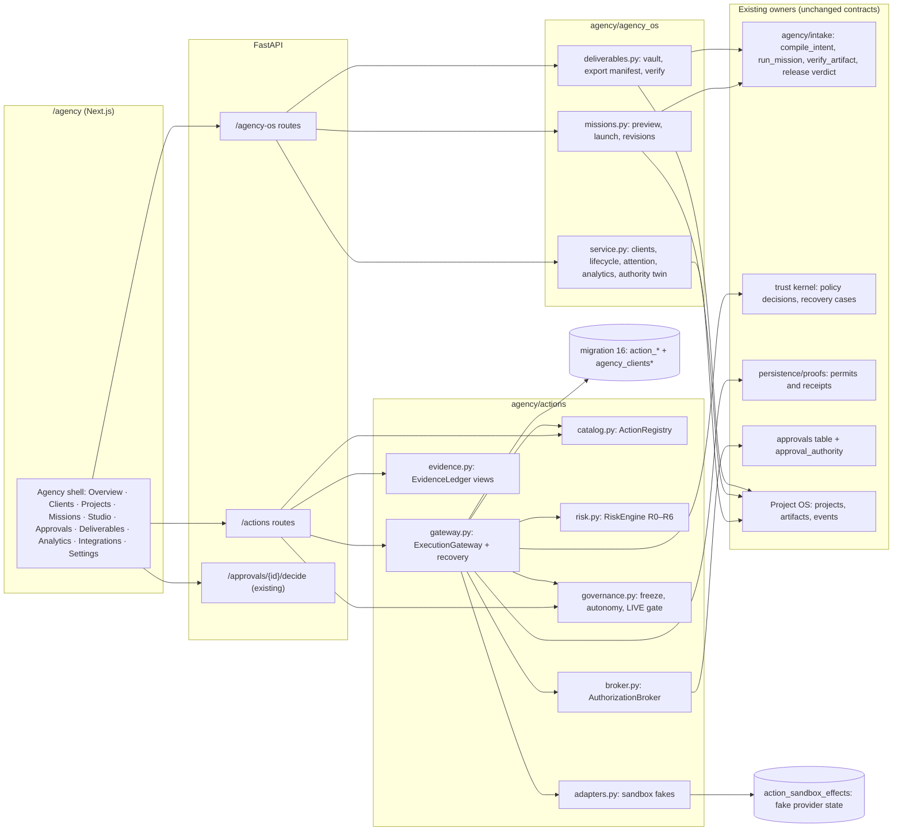
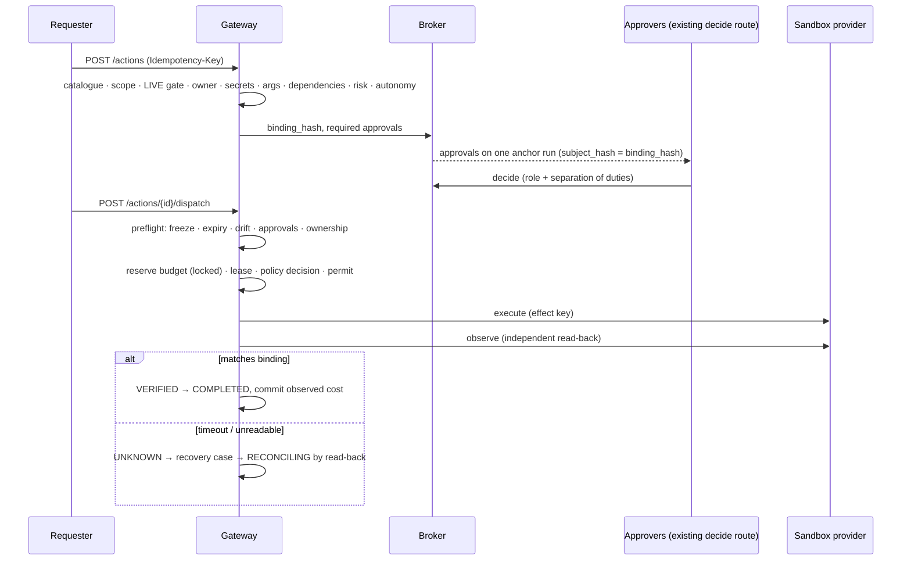
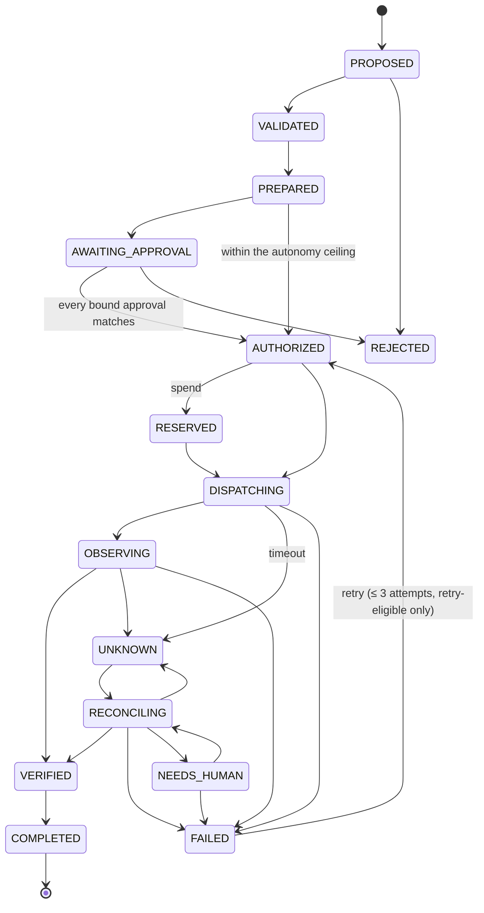

# Architecture

## Components

There is no LIVE edge. Adapters write only to `action_sandbox_effects`, and the gateway refuses
`Environment.LIVE` before an adapter is chosen.

## Request path

## ActionRequest state machine

Every transition is a compare-and-set on `version` and appends a hash-chained row to `action_transitions`.

From `PROPOSED` and `VALIDATED`, a request can also go to `BLOCKED` or `CANCELLED`. From `PREPARED`,
`AWAITING_APPROVAL`, `AUTHORIZED` and `RESERVED`, it can also go to `BLOCKED`, `CANCELLED` or `EXPIRED`.
`COMPLETED`, `REJECTED`, `BLOCKED`, `EXPIRED` and `CANCELLED` are terminal. Source: `agency/actions/fsm.py`.

## Agency lifecycle

`GET /agency-os/projects/{id}/lifecycle` derives each stage only from stored evidence:

Intake → Discovery → Strategy → Identity → Production → Review → Delivery → Distribution → Measurement → Maintenance

- **Distribution** is always `LIVE_GATED`.
- **Measurement** is `NOT_MEASURED` unless measured rows with a source exist.
- No stage is marked done because a step ran. Each stage needs its artifact, verification, approval or manifest.

## Why the gateway is never called from a graph node

LangGraph resumes an interrupted node from its start and re-executes its logic. A side effect inside a node
before an interrupt would therefore repeat. The gateway is only reachable from HTTP routes and tests;
`test_i02_no_graph_node_dispatches_through_the_gateway` scans the graph packages to enforce this.
