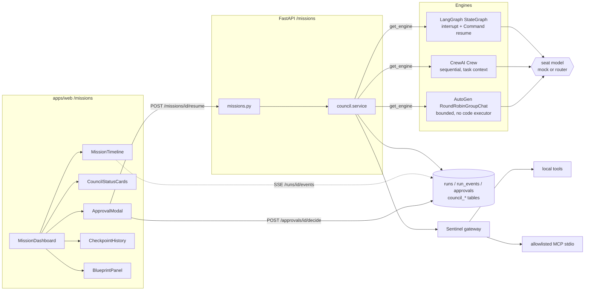

# Mission Council

The Mission Council turns an **idea** into a reviewed **prototype scaffold**. It uses three seats:

- **George** (mission commander) plans the work.
- **Fable/Cipher** (Sentinel) audits it.
- **Arty** (maker) builds a validated UI scaffold, and only after a person approves at the **Sentinel gate**.

The same mission runs on any of three orchestration engines (LangGraph, CrewAI or AutoGen). It is persisted, streamed and checkpointed through the platform's existing primitives:

- A mission is a `runs` row with pipeline `mission_council`.
- Its events are `run_events`, streamed by `/runs/{id}/events`.
- Its gate is an `approvals` row, decided only through `POST /approvals/{id}/decide` (approver role and separation of duties).
- LangGraph uses the shared checkpointer (`persistence/checkpoints.py`).

Code:

| Area | Location |
| --- | --- |
| Domain | `services/langgraph/agency/council/` |
| Persistence | `persistence/council.py` (SQLite migration 19; PostgreSQL `supabase/migrations/20261022_amc_mission_council_v1.sql`) |
| API | `api/routes/missions.py` (`/missions`) |
| UI | `apps/web/components/missions/`, `/missions` (also the **Mission Council** section of `/agency`) |
| Zod twins | `packages/shared/src/schemas/missionCouncil.ts` |

## Architecture



```mermaid
sequenceDiagram
  participant U as Operator
  participant API as /missions
  participant E as Engine
  participant Rv as Reviewer
  U->>API: POST /ideas, POST /dispatch {engine}
  API->>E: start (lease held, thread pool)
  E->>E: George strategy, checkpoint
  E->>E: policy.scan, then Fable audit (monotonic risk), checkpoint
  E-->>API: gate (subject_hash), status needs_approval
  API->>API: approvals row (COUNCIL_GATE)
  Rv->>API: POST /approvals/{id}/decide
  U->>API: POST /missions/{id}/resume
  API->>API: check approval, single use (approval_id, "mission.resume")
  API->>E: resume the paused checkpoint with the decision
  alt approve
    E->>E: Arty scaffold, checkpoint
    API->>API: gateway workspace.write_scaffold (approved WRITE)
    API-->>U: completed
  else reject or subject mismatch
    API-->>U: rejected (terminal; Arty never runs)
  end
```

## Lifecycle and guarantees

**Run statuses:** `queued → running → needs_approval → resuming → completed | rejected | failed | cancelled`.

- **Terminal states never move.** `_transition` refuses to leave them.
- **Retry and recover:**
  - A `failed` mission can be retried from its last checkpoint (`POST /{id}/retry`).
  - A `running` mission whose lease expired can be recovered (`POST /{id}/recover`; `MISSION_LEASE_ACTIVE` while the lease is live).
  - `COUNCIL_RECOVER_ON_STARTUP=true` recovers stale missions when the API starts.
- **Exactly-once start.** The `queued → running` compare-and-set happens under the mission lease.
- **Single-use decisions.** A decision is consumed once per action (`council_approval_consumptions`, PK `(approval_id, action_hash)`), so a replayed resume is refused with `APPROVAL_REPLAY`.
- **Checkpoints.** They are hash-chained (`prev_hash = hash(prev, state)`), and every read re-verifies the chain (`chain_verified`). The LangGraph engine also exposes its native `get_state_history`.
- **Gate binding.** The gate subject is `canonical_hash({mission_id, thread_id, action, requested_actions, strategy_hash, risk_hash, policy_version})`. A decision whose subject, policy version or approval does not match is refused (`APPROVAL_STALE`, `APPROVAL_POLICY_MISMATCH`). A decision that does not match the paused state rejects the mission (`SUBJECT_MISMATCH`).
- **Seat failures.**
  - A seat that times out (`COUNCIL_SEAT_TIMEOUT_SECONDS`) or returns invalid output is retried up to `COUNCIL_SEAT_MAX_ATTEMPTS`.
  - A model that cannot answer (no credential, provider error, degraded outcome) fails the mission with the router's error class, or `PROVIDER_DEGRADED`. It is never replaced by mock output.

## Models: offline by default

`ENABLE_REAL_MODELS=false` (the default) runs every seat on `MockSeatModel`. It is deterministic and needs no network or key; the same idea always yields the same strategy, audit and scaffold. Every engine uses the same seat model through its own adapter: a custom CrewAI `BaseLLM` and an AutoGen `ChatCompletionClient`. Nothing in mock mode opens a socket; the engine tests were also run under `unshare -rn`.

With `ENABLE_REAL_MODELS=true`, seats use `DEFAULT_MODEL_PROVIDER` through the canonical `agency/model_router.py`. The profile is pinned on the mission at dispatch.

## Sentinel policy and the tool gateway

- **Risk.** `policy.scan` is deterministic and runs first. Model findings can only raise risk, never lower it. Any non-READ requested action, or HIGH+ risk, requires approval. A CRITICAL finding (for example a credential in the input) blocks the mission. An idea containing a credential is refused before it is stored (`SECRET_IN_INPUT`).
- **Gateway.** `gateway.invoke` is the only path to a tool:
  - The allowlist is deny-by-default.
  - Each seat has least-privilege scopes (`SEAT_SCOPES`).
  - Arguments are validated by Pydantic or JSON Schema.
  - Each tool has a timeout. SHELL is disabled.
  - A WRITE or EXTERNAL tool needs a decided approval bound to the mission, the action hash and the server-derived target.
  - Every call is audited (ALLOWED / DENIED / FAILED / TIMEOUT) with secrets redacted and file content reduced to sha256 + size.
- **Scaffold writes.** `workspace.write_scaffold` writes atomically, and only under `<AMC_EXPORT_ROOT>/council/<tenant>/<project>/<mission>/scaffold/`, with safe relative paths and size budgets.
- **MCP.** Tools come from operator-declared stdio servers in `AMC_MCP_SERVERS`, using the official `mcp` SDK (the `council` extra):

  ```json
  {"docs": {"command": "/usr/bin/python3", "args": ["-I", "/opt/mcp/docs_server.py"],
            "tools": {"search": {"sensitivity": "READ", "scopes": ["mcp:read"], "timeout_s": 10,
                                 "input_schema": {"type": "object", "properties": {"q": {"type": "string"}}}}}}}
  ```

  The rules for MCP servers:
  - Only allowlisted tools are reachable.
  - The command must be an absolute path.
  - The server gets a minimal environment, with no credentials passed through.
  - Unavailable servers, tool errors, missing tools and timeouts become typed errors.
  - `GET /missions/tools` lists the effective allowlist and any configuration errors.
  - No HTTP route invokes an arbitrary tool. Seats reach tools only through the gateway; today that is the approved scaffold write.

## Ideas, blueprints and promotion

1. `POST /missions/ideas/{id}/blueprints` takes the best parts of the idea's missions:
   - the strategy with the most tasks;
   - the scaffold with the most components;
   - the union of every security finding at its highest severity, recording which missions raised it.

   Only completed missions contribute strategy and scaffold.
2. `POST /missions/blueprints/{id}/promote` re-verifies each source mission's timeline before promoting. The checks are:
   - contiguous sequences starting at `MISSION_QUEUED`;
   - approval applied after it was required;
   - a verified checkpoint chain;
   - status `completed`.

   Any failure is refused with `TIMELINE_VERIFICATION_FAILED`.

## API

| Method | Path | Notes |
| --- | --- | --- |
| GET | `/missions/engines` | availability per engine, model mode |
| GET | `/missions/tools` | gateway allowlist, MCP state |
| POST/GET | `/missions/ideas`, `/missions/ideas/{id}` | idea + its missions and blueprints |
| POST | `/missions/dispatch` | `{idea_id, engine, materialize_scaffold}` → 202 |
| GET | `/missions?project_id=`, `/missions/{id}` | cursor pagination |
| GET | `/missions/{id}/timeline`, `/checkpoints`, `/tool-audits` | |
| POST | `/missions/{id}/resume`, `/cancel`, `/retry`, `/recover` | |
| POST | `/missions/ideas/{id}/blueprints`, `/missions/blueprints/{id}/promote` | |

- **Idempotency.** Every write requires `Idempotency-Key`.
- **Errors.** They use the AMC envelope with deterministic codes, such as `UNSUPPORTED_ENGINE` (400), `ENGINE_UNAVAILABLE` (503), `APPROVAL_PENDING` (409) and `RUN_LIMIT_EXCEEDED` (429).
- **Request ids.** Every response carries `X-Request-ID`; a valid incoming value is echoed.
- **Live updates.** Live events come from `GET /runs/{mission_id}/events?follow=true` (SSE).

## Launch

```bash
cp .env.example .env              # ENABLE_REAL_MODELS=false, DEFAULT_MODEL_PROVIDER=mock, SQLite
python -m pip install -e "./services/langgraph[dev]"            # LangGraph engine
python -m pip install -e "./services/langgraph[dev,council]"    # + CrewAI, AutoGen, MCP (Python 3.11)
python -m uvicorn services.langgraph.app.main:app --host 127.0.0.1 --port 8000
NEXT_PUBLIC_API_BASE_URL=http://127.0.0.1:8000 pnpm --filter @amc/web dev --hostname 127.0.0.1 --port 3000
python scripts/seed_council_demo.py --tenant tenant_1 --project proj_1   # optional, idempotent demo idea
```

Open <http://127.0.0.1:3000/missions>. Approving needs a second principal with an approver role: the person who dispatched a mission cannot approve it. With `AMC_AUTH_MODE=local`, restart the API with another `AMC_LOCAL_USER_ID` and `AMC_LOCAL_ROLE=reviewer`, or use Supabase auth.

## Tests

```bash
python -m pytest -q services/langgraph/tests/test_missions_council.py services/langgraph/tests/test_council_*.py
pnpm --filter @amc/shared test && pnpm --filter @amc/web test
E2E_BASE_URL=http://127.0.0.1:3000 pnpm --filter @amc/web test:e2e -- missions.spec.ts
```

- **Where they run.** The CI job `backend-council` installs the `council` extra and runs the council tests on all three engines offline. The default backend jobs (SQLite and PostgreSQL) run them with only LangGraph; tests that need an absent engine are skipped.
- **Ported suites.** `test_council_ported_scenarios.py` ports the supplied router, CrewAI and end-to-end suites onto the real API and engines.
- **Their original form.** The supplied suites tested only their own embedded mocks. Their CrewAI case needed `OPENAI_API_KEY`, because that crew had no LLM configured.

## Dependency advisories

CI's `Dependency audit` job runs `pip-audit` over the `council` extra as well as the base install. CrewAI 1.15.28 is the latest release, and it pins `chromadb~=1.5.9`, `mcp~=1.28.1` and, through `crewai-cli`, `uv~=0.11.6`. While CrewAI is installed, these advisories cannot be upgraded away, so the job ignores exactly these IDs. Any other advisory in the tree fails it.

| Package | Advisory | Affects | Why the council is not exposed |
| --- | --- | --- | --- |
| chromadb 1.5.9 | PYSEC-2026-311, -3813, -3814, -3815 (no fix released) | The Chroma **server**: HTTP API code injection, RBAC tenant checks | Chroma is only imported by CrewAI. No Chroma server runs, and the crew sets no memory, knowledge or embedder. |
| mcp 1.28.1 | CVE-2026-59951 (fixed in 1.30.0) | Streamable HTTP **server** session cleanup | The council uses only the stdio **client**, to operator-allowlisted servers. |
| uv 0.11.33 | PYSEC-2026-4321 (fixed in 0.13.4) | The `uv` CLI's TLS root bundle | Nothing in the council runs `uv`. It is a `crewai-cli` dependency. |

Remove an ID from the workflow once CrewAI lifts the pin. Without CrewAI, `mcp` resolves to a patched version.

## Build plan (what is next)

- **Model-backed seats in CI.** Keep the default offline. Add an opt-in job with a provider secret that runs the same suites with `ENABLE_REAL_MODELS=true`.
- **More gateway tools for seats.** For example, read-only MCP retrieval for George. Each new tool needs an allowlist entry, scopes and its own approval rule.
- **Promotion into execution.** Promote blueprints into the execution fabric (`agency/execution_fabric/`) as work orders, rather than stopping at a promoted record.
