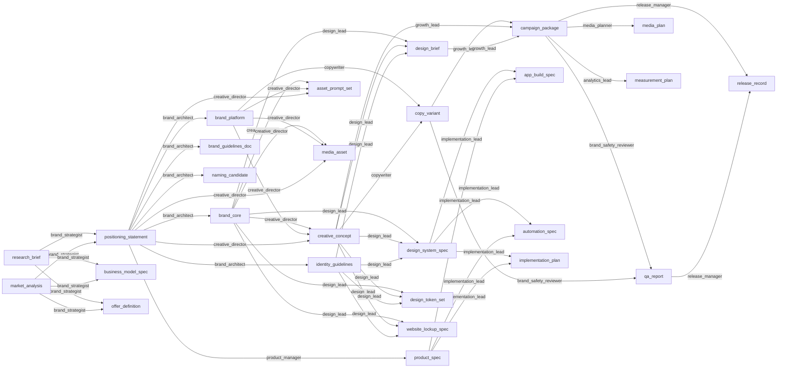

# AMC system audit

**Audited commit:** `c6b5a7007ac246c6ce31022baf8cdf3843c213e7` (`master`, 2026-10-17).
**Method:** static source inspection, the generated inventory, and earlier test runs on this codebase. Nothing was deployed or observed in production. Every "live" statement below therefore means "the code would allow it", never "it was seen working in production".

| Source | What it gives |
|---|---|
| `docs/system_inventory.generated.md` | Counts and tables taken from the code itself: the route table, migrations, environment variables, tests, kernel vocabulary, action catalogue, skills, pages and CI jobs. Regenerate with `python scripts/system_inventory.py`. |
| Static import scan (this audit) | Modules no production code imports. |
| Increment test runs | I03 full backend suite at `fefa4504`: 1297 passed, 2 skipped, 1 failed. The failure is a test-isolation issue, see F-09. All 7 CI checks were green on that commit. |

Capability states used throughout:

| State | Meaning |
|---|---|
| IMPLEMENTED | Code exists and is tested; it runs without external credentials. |
| LOCAL_ONLY | Runs on the host with local tools (Blender, FFmpeg, Chromium) and never calls a hosted provider. |
| SANDBOX_ONLY | Effects go only to sandbox tables or fakes. |
| DRY_RUN_ONLY | Produces a plan or preview of an effect, never the effect. |
| PLANNING_ONLY | Compiles plans or specifications; nothing executes them. |
| DEGRADED | Runs, but marks its output as not deliverable. |
| PROVIDER_GAP | No adapter exists for the provider. |
| BLOCKED | Refused by policy or by a missing prerequisite. |
| VOID_DETECTED | Referenced id with no source definition. |

## 1. Size and shape

From the generated inventory:

| Item | Count |
|---|---|
| Python packages under `services/langgraph` | 32 |
| Python source lines, excluding tests | 68,689 |
| HTTP operations | 218 |
| HTTP operations with no detected auth | 3 (`/health`, `/ready`, `/version`: liveness and public metadata, by design) |
| HTTP operations that authenticate inside the handler | 1 (`POST /runtime/ingest`: HMAC signature or principal) |
| SQL migration files | 14 |
| Backend test files / test functions | 87 / 1,060 (about 1,300 collected cases with parametrisation) |
| Web pages | 4 (`/`, `/agency`, `/login`, `/mission-control`) |
| Web component files | 41 |
| Zod schema files / parity fixtures | 17 / see inventory |
| Kernel artifact types / role contracts | 28 / 13 |
| Action catalogue entries | 32 |
| Registered skills | 11 |
| Model providers in the router | 4 (`openai`, `anthropic`, `gemini`, `ollama`) |
| CI workflows | 4 (`ci.yml` runs the 5 gating jobs) |

## 2. Subsystem status

| Subsystem | Location | State | Evidence | Main gap |
|---|---|---|---|---|
| Agency pipeline (Layer 1) | `graph/agency/` | IMPLEMENTED; DEGRADED without a model credential | `build.py`; `interrupt_before=["delivery"]`; nodes bind N3 roles (`LIVE_STAGE_ROLE_BINDINGS`) | Runs synchronously inside the HTTP request (`api/routes/agency.py` → `_run_and_record_events`). |
| Model routing | `agency/model_router.py`, `model_profiles.py`, `graph/agency/llm.py` | IMPLEMENTED (fake transport); no live call observed | `test_amc_i03_model_profiles.py` | No settings API for project or tenant profiles. The legacy `graph/nodes/planner.py` and `quality/grounded_evaluator.py` still use OpenAI only. |
| Governance kernel N1–N4 | `agency/kernel/` | IMPLEMENTED | 28 artifact types, 13 roles; `verify_ontology_parity.py` | Not every new subsystem maps its outputs onto N1 types (see §5). |
| Project OS | `agency/project_os/`, `persistence/projects*.py` | IMPLEMENTED (SQLite and Postgres) | `docs/project-os.md`; migration `20261001_amc_project_os_v1.sql` | Publishing is DRY_RUN_ONLY. Paid media is PLANNING_ONLY. R2 is PROVIDER_GAP. KnowledgeOps has no embeddings or vector retrieval: the only "embedding" reference is in `prompt_families/ledger.py`. |
| Execution fabric | `agency/execution_fabric/` | IMPLEMENTED for local adapters | 11 skills | Text, T2I, AI video and search-volume skills are PROVIDER_GAP (`t2i_image_generate`, `ai_video_generate`, `seo_search_volume`). The code sandbox is Python-only. |
| Creative search runtime | `agency/creative/` | IMPLEMENTED, deterministic | `docs/creative-runtime.md` | Model-backed types plan BLOCKED (`provider_gap`). `creative/brand_production.py` has no production importer (F-04). |
| Local visual engine | `agency/visual/` | LOCAL_ONLY | Blender and FFmpeg runners; probes | R2 diffusion and R3 Three.js are BLOCKED until weights or runtime and a licence record exist. |
| Creative Foundry | `agency/foundry/`, `api/routes/foundry.py` | LOCAL_ONLY | `docs/creative-foundry.md` | Discovery adapters DISABLED. No React output, print contracts or extra scenes. |
| VNEXUS ACE | `agency/vnexus/`, migration `20261011_amc_vnexus_v1.sql` | IMPLEMENTED; hosted media DISABLED | `docs/vnexus-ace.md` | Hosted media providers have no network code. The 14 original prompts are absent (SOURCE_REQUIRED). |
| ACE v12 action plane | `agency/actions/`, migration `20261012_amc_actions_v1.sql` | SANDBOX_ONLY | `live_enablement()` returns DISABLED; adapters are `Sandbox*` classes | No live adapters. No step-up authentication (`STEP_UP_UNAVAILABLE`). Budget API is read and simulate only. No shared rate limiter. |
| Agency OS app | `agency/agency_os/`, `/agency-os`, `apps/web/app/agency` | IMPLEMENTED | E2E `agency-os.spec.ts` | Deliverables are UNSIGNED unless `AMC_DELIVERY_SIGNING_KEY` is set, and that variable is undocumented (F-06). |
| Delivery contracts | `agency/delivery/` | IMPLEMENTED; default `AMC_CONTRACT_MODE=off` | `docs/unified-delivery.md` | Shadow, then enforce, rollout not started. |
| Durable runtime | `agency/durable/`, migration `20261009_…` | IMPLEMENTED; not running | `build_dag.runtime_active` requires a deployed worker | No deployed worker or heartbeat (NOT_MEASURED). `durable/proofs.py` has no production importer (F-04). |
| Intake mission | `agency/intake/` | IMPLEMENTED (LOCAL mode) | `docs/intake-mission.md` | No route or UI: Python-only by design. |
| Compiled planner and method router | `agency/compiled/` | PLANNING_ONLY | `compile_method_mission` reports `EXECUTOR_GAP` | Layer 1 does not consume compiled plans. |
| Prompt compiler, families, cinematic | `agency/prompt_compiler.py`, `prompt_families/`, `cinematic/` | PLANNING_ONLY (stops at `PROMPT_PACKAGE_READY`) | module docstrings | Nothing consumes the prompts for generation (no T2I or T2V adapter). |
| UI/UX compiler and DTCG | `agency/ui_ux/`, `agency/design_tokens.py` | IMPLEMENTED (`UIUX_SPEC_READY`) | `docs/ui-ux-design-compiler.md` | Specs only. No design-to-code generation of a client site. |
| Design Mode style catalogue | `agency/design/`, `/design` | IMPLEMENTED | `packages/shared/style-library/design-styles.json` | — |
| Publication, paid media, Zo | `integrations/` | publication DRY_RUN_ONLY; paid media disabled; Zo read-only | `verify_production_readiness.py` | No live executor by design. |
| Auth and tenancy | `security/auth.py`, `persistence/memberships.py` | IMPLEMENTED (`local` dev, `supabase` production) | `verify_auth_bindings.py` | Production identities and memberships not verified in an environment. |
| Release evidence | `agency/ace_evidence.py`, `ace_release.py` | IMPLEMENTED (unsigned) | `docs/ace-v100/evidence/` | No externally held signing key. No independent fault-injection or security gate. |
| Observability | `agency/durable/observability.py` | Opt-in OTel; nothing exported | `AMC_OTEL_EXPORT` (undocumented) | No collector, dashboards or alerts. Ingestion NOT_MEASURED. |

## 3. Workflow maps

### 3.1 Agency pipeline: the live path behind `POST /agency/runs`

```
brief_intake ─▶ brand_strategy ─▶ creative_concepting ─▶ copywriting ─▶ design_brief
 market_researcher brand_strategist   creative_director      copywriter    design_lead
                                                                             │
delivery ◀─(interrupt; /approvals/{id}/decide)─ hitl_gate ◀─ brand_safety_qa ◀─ campaign_assembly
release_manager                                 release_manager brand_safety_reviewer growth_lead
```

- **Run creation pins** the workflow (`metadata.workflow`), the delivery contract and the model profile (`metadata.model_profile`).
- **Generation:** four stages call `generate_structured`.
- **Release** needs four things: the N2 `release_guard_failures` check, no degraded provenance, an approved and non-stale approval with a matching subject, and separation of duties (production).
- **Delivery** writes the workspace export and artifact bindings. It does not publish.
- **v2-contract topology** inserts `contract_check` between `brand_safety_qa` and `hitl_gate`.

### 3.2 Other workflows

| Workflow | Path | Terminal state |
|---|---|---|
| Project OS run | run → `project_events` (`WORK_STARTED`, `APPROVAL_REQUIRED`) → dual materialisation under `<export>/projects/<tenant>/<project>/` → scheduler tick → outbox → `OutboxDispatcher` | Dry-run delivery receipts |
| Execution fabric | compiled waves → freshness and eligibility → idempotency reservation and `DispatchPermit` → `dispatch_skill` → validators → `create/revise_project_artifact` → `ExecutionReceipt` → read-back `ObservationReceipt` | Per-cell `ExecutionState`; deliverables stop at NEEDS_HUMAN |
| Creative runtime | MissionIR → plan → context → candidates → hard gate → blind critics → Pareto → HUMAN → ≤1 correction → approval | `delivery_gate`, which never delivers |
| Visual engine | probe → route (R1/R4/R5; R2/R3 BLOCKED) → render → `media_asset` → `verify_media` Q0–Q4 | Q5–Q7 are `human_required` |
| Creative Foundry | `compile_genome` → grammars → CompositionIR/SVG → variants → experience twin (Chromium) → scene and motion → proof state | `open_artifact_approval` |
| VNEXUS | genome DRAFT → submit (`open_artifact_approval`) → decide → `settle_version` → APPROVED → production projection | Foundry store and observe |
| ACE v12 action | propose → broker → anchor run and approval (`subject_hash = binding_hash`) → `preflight` (freeze, expiry, step-up, uncertainty debt) → sandbox adapter → read-back | COMPLETED, or UNKNOWN → reconcile |
| Delivery contract (shadow/enforce) | `ReleaseCandidateManifest` sealed before approval → `evaluate_release_predicate` on resume | `ReleaseReceipt` |
| Durable runtime | lease → precheck → write-ahead intent → dispatch → read-back → verify → fenced commit | At-least-once. No worker deployed. |
| Intake mission | `compile_intent` → `resolve_project` → `compile_context` → planner → `execute_mission` (LOCAL) → `verify_artifact` → approval | `release_gate`. Publish, spend and send get a `NonActionReceipt`. |

## 4. Artifact dependency graph (N1/N3)

Edges are role `consumes → produces`, from `agency/kernel/roles.py` (`role_snapshot()`). Every role requires human approval except `brand_safety_reviewer`. Only `media_planner` and `release_manager` declare an external side effect.



`market_researcher` produces `research_brief`, `market_analysis` and `knowledge_capsule` and consumes nothing: it is the root.

`release_record` is the only terminal release artifact. Invalidation follows `depends_on` edges in `artifact_versions` and the invalidation ledger (migration `20260825_amc_invalidation_ledger_v1.sql`).

## 5. Findings

| ID | Finding | Evidence | Impact | Register |
|---|---|---|---|---|
| F-01 | **The completion evaluation records constant scores.** `_record_completion` sets `evidence_score` and `quality_score` equal to `proof_coverage`, which callers pass as the literals 0.25, 0.67 and 1.0. | `api/routes/agency.py` (`_record_completion` and its three call sites); `execution/models.py` `CompletionEvaluation`; Zod `quality_score` in `packages/shared/src/schemas/agency.ts` | A measured-looking quality score that nothing measured. This conflicts with the no-fabricated-metrics rule. | G-01 (P0) |
| F-02 | **Agency runs execute synchronously** inside the create and resume requests. | `create_agency_run` → `_run_and_record_events` | A request timeout or worker restart mid-run. No job id, progress, cancellation or SSE. | G-05 (P0) |
| F-03 | **The legacy generic graph is unreachable.** `graph/build.py` and its 7 nodes are not mounted by `app/main.py`; only `test_human_review.py` imports one node. `graph/nodes/planner.py` calls OpenAI directly. | Static import scan | Dead code that bypasses the model router, so it could be wired back in by mistake. | G-34 (P1) |
| F-04 | **Modules imported only by tests:** `durable/proofs.py`, `creative/brand_production.py`, `quality/grounded_evaluator.py`, `quality/request_accut.py`. `agency/reliability/api.py` (`create_reliability_router`) is never mounted. | Static import scan | Capabilities described in docs that no runtime path reaches. | G-35 (P1) |
| F-05 | **`GenerationProvenanceSchema` (Zod) omits the I03 provenance fields** `route`, `profile_hash`, `usage_reported` and `unreported_token_estimate`. Zod strips them silently. | `packages/shared/src/schemas/agency.ts` vs `graph/agency/llm.py` | The UI cannot show unknown usage or fallback routes. | G-02 (P0) |
| F-06 | **19 environment variables are read but undocumented.** They include secrets and safety switches: `AMC_DELIVERY_SIGNING_KEY`, `AMC_HMAC_SECRET`, the R2 keys, `AMC_ACTIONS_FREEZE` and `AMC_OTEL_EXPORT`. | Inventory, environment-variable section | Operators cannot discover or rotate them. `AMC_ACTIONS_LIVE` is read only to report that it is ignored, which is correct. | G-03 (P0) |
| F-07 | **No action rate limiter, no budget allocation API, no step-up authentication.** | `agency/actions/` (GET `/budget` and POST `/budget/simulate` only); `gateway.py` `STEP_UP_UNAVAILABLE` | Live activation is impossible by design today. These are prerequisites. | G-06, G-07, G-08 |
| F-08 | **KnowledgeOps has no semantic retrieval.** There are no embeddings or vector index for research and brand memory. | Keyword scan | The Phase 2 research engine and brand graph retrieval need it. | G-12 |
| F-09 | **One test is not hermetic.** `test_project_workspace.py::test_same_idempotency_key_never_creates_two_projects` uses a fixed display name, so it fails on a re-run against the same SQLite file (409 on the slug). | Reproduced locally; passes on a fresh DB and in CI | Local re-runs give false failures. | G-04 (P0) |
| F-10 | **`opentelemetry` is not declared** in `pyproject.toml`, yet `test_ace_observability.py` imports it. CI gets it transitively. | Increment-02 run | A fresh minimal install fails one test. | G-03 (P0) |
| F-11 | **The production capabilities the brief names have no implementation:** print preflight (no CMYK, dieline or bleed checks), Lottie export, sitemap and schema.org output, domain and trademark availability checks, dark-pattern and AI-disclosure checks, Node sandbox, live CMS, email, social, ads, CRM or storage adapters, telephony. | Keyword scan: 0 hits for `CMYK`, `dieline`, `lottie`, `sitemap`, `schema.org`, `dark pattern` in backend source | These remain PROVIDER_GAP or missing, and must not be claimed. | G-13 to G-31 |
| F-12 | **None of the 32 action catalogue entries can go live.** Live status: 24 `LIVE_GATED`, 3 `NOT_IMPLEMENTED`, 3 `PROVIDER_GAP`, 2 `UNAVAILABLE`. `live_enablement()` returns `DISABLED`. | Inventory, action catalogue | Correct fail-closed state. Live readiness is per-adapter work. | G-09 |

**No unauthenticated data route was found:** every route other than liveness and public metadata resolves a principal. **No migration gap was found** for the tables the code writes in Postgres: the CI `Backend on PostgreSQL` job applies all 14 migrations and runs the suite.

## 6. What this audit does not establish

- **Behaviour in a deployed environment.** Identities, memberships, CORS, secrets, workers, telemetry and provider calls are all unobserved.
- **Code-quality findings beyond lint.** Ruff reports 8 existing findings in `graph/agency/nodes.py` (unused imports and variables). No other static analysis or security scanner was run for this audit.
- **Completeness of the dead-code list.** The import scan is static: modules loaded by path (the Blender and diffusion runners, the subprocess scripts) are reachable even though nothing imports them. Dynamic imports could hide other users.
- **Asset quality, design quality or campaign effectiveness.** None of these were measured; they stay NOT_MEASURED.
